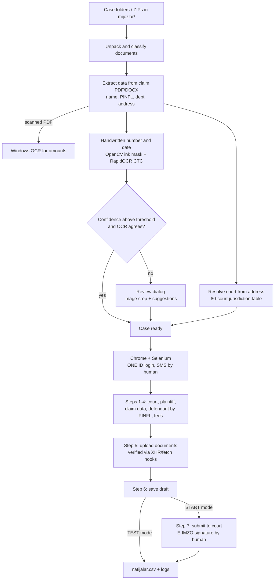

# ADOLAT Court Automation

**Desktop RPA tool that prepares and files civil debt-collection claims on Uzbekistan's e-court portal (`cabinet.sud.uz`) in batches — with OCR for handwritten registration numbers, automatic court jurisdiction lookup, and a companion court-fee receipt generator for `billing.sud.uz`.**


---

## Overview

This tool was built for the legal department of a company in Uzbekistan that files large numbers of simplified civil claims for debt recovery. Each case arrives as a folder (or ZIP) of documents: the claim itself (PDF/DOCX), the contract/act, a demand letter, a debt statement exported from 1C, a postal receipt, a passport copy and a court-fee receipt.

Filing one case manually on the national e-court portal means walking through a 7-step web wizard, re-typing data from the documents, choosing the correct court for the defendant's address and uploading ~10 files. With hundreds of cases per batch this is slow and error-prone.

**ADOLAT Court Automation** reads the documents, extracts the data, decides which court has jurisdiction, and drives a real Chrome browser through the whole wizard — while keeping a human in the loop only where the law or the portal requires it (ONE ID/SMS login, the math CAPTCHA and the E-IMZO digital signature).

> The user interface, logs and identifiers are in Uzbek (Latin script), as the tool was written for Uzbek-speaking staff.

## Features

**Document intake**
- Batch processing of every case folder in `mijozlar/`; ZIP archives are unpacked automatically (including legacy cp866 Cyrillic file names), nested “Extract all” folders are flattened, Windows long paths are handled.
- Document type detection by file-name keywords (claim, power of attorney, offer, contract/act, demand letter, postal receipt, 1C debt statement, certificate, passport, payment receipt); unnamed PDFs are recognised as `billing.sud.uz` receipts by their content.
- Shared documents in `umumiy_hujjatlar/` are attached to every case unless the case folder already has its own copy.

**Data extraction**
- Regex-based parsing of claim PDFs/DOCX (Latin and Cyrillic templates): defendant full name, PINFL (14 digits), passport, principal debt, postal costs, address and the court named in the claim.
- Repairs PDFs whose Cyrillic text was extracted with the wrong code page (cp1251 shown as Latin-1).
- Scanned (text-less) claims: amounts are read with the built-in **Windows OCR** engine (`Windows.Media.Ocr`, called through PowerShell — no extra install); name/passport/address fall back to the contract, demand letter or postal receipt.

**Handwritten number & date recognition**
- The registration number and date are written by hand (blue pen) on each claim. The tool crops that area, segments the ink in HSV colour space with **OpenCV**, and scores digit strings with the **RapidOCR (PaddleOCR, ONNX)** recogniser using a digits-only CTC model plus prefix beam search.
- OCR evidence is combined with prior knowledge — *number = folder number + constant batch offset*, numbers grow with dates, a number cannot repeat, previously submitted cases — into a joint probability for (number, date).
- Values are auto-accepted only when the confidence is above a configurable threshold **and** the raw OCR agrees; everything else goes to a review dialog that shows the image crop with the top suggestions. Results are cached so each PDF is read once.

**Court jurisdiction**
- Determines the competent civil court from the defendant's address using a public table of 80 civil courts (`Fuqarolik_sudlari_yurisdiksiya.xlsx`).
- Uzbek/Russian, Cyrillic/Latin transliteration and consonant-“skeleton” matching tolerate spelling variants and OCR noise; street/mahalla names are not mistaken for districts.
- Alternatively uses the court written in the claim, or a single configured court for all cases.

**Browser automation**
- Starts the regular Google Chrome with a persistent profile and a remote-debugging port, then attaches Selenium — the ONE ID session and the E-IMZO extension survive between runs.
- A JavaScript helper library handles Angular Material widgets (selects, date picker), finds fields by label/placeholder, and intercepts file inputs so uploads never open an OS dialog.
- Upload completion is verified by patching `XMLHttpRequest`/`fetch` to count in-flight uploads, plus spinner detection — no fixed sleeps.
- Human-like randomised pauses with speed presets (Fast / Medium / Slow / Manual).
- Detects portal messages (defendant not found or deceased, unpaid fees, maintenance), retries a failed case on a fresh page, and re-opens an already saved draft instead of creating a duplicate.

**Modes & UI**
- *TEST* (fill and save as draft, do not submit), *TEST up to step 5* (upload documents, then stop), and *START* (full submission).
- Tkinter desktop app: colour-coded case table, live log, progress bar, a yellow “action needed” banner with a beep, settings dialog, and a *Stop* button that closes Chrome immediately via the DevTools protocol.
- Also has a console (CLI) mode with the same processing pipeline.

**Companion tools**
- `adolat_avtomat2.py` — variant for court-order (*buyruq*) applications that reuses the same engine with different wizard settings and its own data folder.
- `kvitansiya_yaratish.py` — separate GUI that creates postal-fee receipts on `billing.sud.uz` for each case's court, downloads the PDF through the site API into the case folder, and keeps a journal so receipts are never created twice. Existing receipts are validated (court, amount, expiry date, payer TIN).

**Reporting & packaging**
- `natijalar.csv` (result per case), `ishlar.xlsx` (editable case table), and a screenshot + DOM dump of every wizard page in `loglar/`.
- `exe_yasash.bat` builds three Windows executables with PyInstaller; `zip_yasash.ps1` packages them for distribution **without** any case data or credentials.

## How it works



## Tech stack

| Area | Technology |
|---|---|
| Language | Python 3.13 (stdlib: `tkinter`, `ctypes`, `configparser`, `difflib`, `dataclasses`, `threading`) |
| Browser automation | Selenium 4, Chrome DevTools Protocol (`websocket-client`), injected JavaScript |
| PDF / Office | PyMuPDF, python-docx, openpyxl |
| OCR / CV | Windows.Media.Ocr (PowerShell), RapidOCR (`rapidocr-onnxruntime`), OpenCV, NumPy |
| Security | Windows DPAPI (`CryptProtectData`) for the stored password |
| Packaging | PyInstaller (one-dir, windowed), PowerShell `Compress-Archive` |

## Project structure

```
adolat-court-automation/
├── adolat_avtomat.py                  # main app: data extraction, OCR, court lookup, Selenium wizard, Tkinter GUI, CLI
├── adolat_avtomat2.py                 # court-order ("buyruq") variant built on the same engine
├── kvitansiya_yaratish.py             # court-fee receipt generator for billing.sud.uz (separate GUI)
├── Fuqarolik_sudlari_yurisdiksiya.xlsx# public reference table: 80 civil courts and the districts they serve
├── QOLLANMA.txt                       # end-user manual (Uzbek)
├── exe_yasash.bat                     # PyInstaller build of all three apps
├── zip_yasash.ps1                     # packages the builds for distribution (no personal data)
├── versiya_info.txt                   # Windows version resource for the .exe
├── sozlamalar.example.ini             # example settings -> copy to sozlamalar.ini
├── .env.example                       # optional environment variables
└── requirements.txt
```

Runtime folders created next to the app (all git-ignored, they contain personal data):

```
mijozlar/<case folder>/      # one folder (or ZIP) per case with its documents
umumiy_hujjatlar/            # documents shared by all cases
loglar/                      # logs, page screenshots and DOM dumps
ishlar.xlsx, natijalar.csv   # case table and results
parol.dat                    # DPAPI-encrypted password
ocr_*_kesh.json, raqam_tarixi.json   # OCR caches and submitted-number history
```

## Setup

**Requirements:** Windows 10/11, Google Chrome, Python 3.11+ (developed on 3.13).

```powershell
git clone https://github.com/Umar37-max/adolat-court-automation.git
cd adolat-court-automation
python -m venv .venv
.venv\Scripts\activate
pip install -r requirements.txt
copy sozlamalar.example.ini sozlamalar.ini   # then edit the values
```

Selenium Manager downloads a matching ChromeDriver automatically.

### Configuration (`sozlamalar.ini`, section `[ADOLAT]`)

| Key | Description |
|---|---|
| `sayt` | E-court cabinet URL (`https://cabinet.sud.uz`) |
| `login` / `parol` | ONE ID credentials. The password is moved to `parol.dat` (DPAPI-encrypted) and erased from the ini on first start |
| `profil_stir` | TIN of the organisation profile selected after login |
| `asosiy_davogar` | Plaintiff organisation as listed on the portal |
| `qoshimcha_davogar_stir`, `qoshimcha_davogar_belgi` | Optional co-plaintiff added by TIN search, and a word expected in the search result |
| `viloyat`, `sud`, `sud_hammaga_toshkent` | Fallback region/court; “all cases to one court” switch |
| `nizo_turi`, `ariza_turi`, `ish_turkumi`, `qoshimcha_ish_turkumi`, `kichik_biznes`, `davlat_boji_imtiyozi` | Values selected in the wizard drop-downs |
| `tezlik`, `pauza_min`, `pauza_max`, `harf_pauza`, `kechikish_koef`, `kutish_soniya`, `mijozlar_orasida` | Speed preset, human-like pauses and timeouts |
| `ocr_avto`, `ocr_ishonch` | Auto-accept OCR results and the confidence threshold (default 0.90) |
| `yuborishdan_oldin_sorash`, `xatoda_kutish` | Ask before each submission; seconds to wait for manual fixes on error (0 = skip case) |
| `kvitansiya_*` | Receipt generator: payer organisation, TIN, address, fee amount, payment type |

### Environment variables (optional)

| Variable | Purpose |
|---|---|
| `ADOLAT_LOGIN`, `ADOLAT_PROFIL_STIR`, `ADOLAT_ASOSIY_DAVOGAR`, `ADOLAT_QOSHIMCHA_DAVOGAR_STIR` | Defaults for the corresponding ini keys |
| `ADOLAT_PAROL` | ONE ID password (overrides `parol.dat`) |
| `KVITANSIYA_TASHKILOT`, `KVITANSIYA_STIR`, `KVITANSIYA_MANZIL` | Defaults for the receipt generator payer |
| `ADOLAT_FON` | Run Chrome headless |
| `ADOLAT_AVTO_TEST`, `ADOLAT_SKRIN`, `KV_SKRIN` | Internal UI self-test and screenshots |
| `BUILD_VENV` | Virtualenv used by `exe_yasash.bat` |

## Usage

```powershell
python adolat_avtomat.py                 # GUI (default)
python adolat_avtomat.py --jadval        # create/update ishlar.xlsx from the case folders
python adolat_avtomat.py --tekshir       # validate cases only, no browser
python adolat_avtomat.py --terminal      # TEST run in the console: fill in and save drafts, do not submit
python adolat_avtomat.py --yuborish      # submit the prepared cases to court
python adolat_avtomat.py --mijoz 044     # only case folders whose name contains "044"
python adolat_avtomat.py --qayta         # also re-process cases that were already saved/submitted
python adolat_avtomat.py --parol         # replace the stored password
python adolat_avtomat.py --brauzer-tekshir   # check that Chrome + ChromeDriver start

python adolat_avtomat2.py                # court-order variant (GUI)
python kvitansiya_yaratish.py            # receipt generator (GUI); --tekshir lists what would be created
```

Typical workflow in the GUI: drop case ZIPs into `mijozlar/` → **Refresh** → wait for background OCR → confirm the highlighted numbers/dates → **TEST** (saves drafts) → **START** (submits). Build standalone executables with `exe_yasash.bat`.

## Security & privacy note

- **No personal data is included in this repository.** Case folders, case tables, results, logs, OCR caches and the submitted-number history are created at runtime and excluded by `.gitignore`.
- Credentials and organisation details are never hard-coded: they come from `sozlamalar.ini` (git-ignored) or environment variables; the password is stored only in DPAPI-encrypted form (`parol.dat`, readable by the same Windows user only).
- Code comments use placeholder names and numbers only. The only bundled data file is a public reference table of court jurisdictions.
- The distribution script packages program files only, never case data or credentials.

---

**O‘zbekcha:** ADOLAT AVTOMAT — da'vo arizalarini `cabinet.sud.uz` orqali avtomatik tayyorlash va sudga yuborish uchun Windows dasturi. Hujjatlardan ma'lumotlarni o‘zi oladi, qo‘lda yozilgan raqam va sanani OCR bilan o‘qiydi, javobgar manzili bo‘yicha sudni aniqlaydi va `billing.sud.uz` da kvitansiya yaratadi. Shaxsiy ma'lumotlar repozitoriyga kiritilmaydi.
